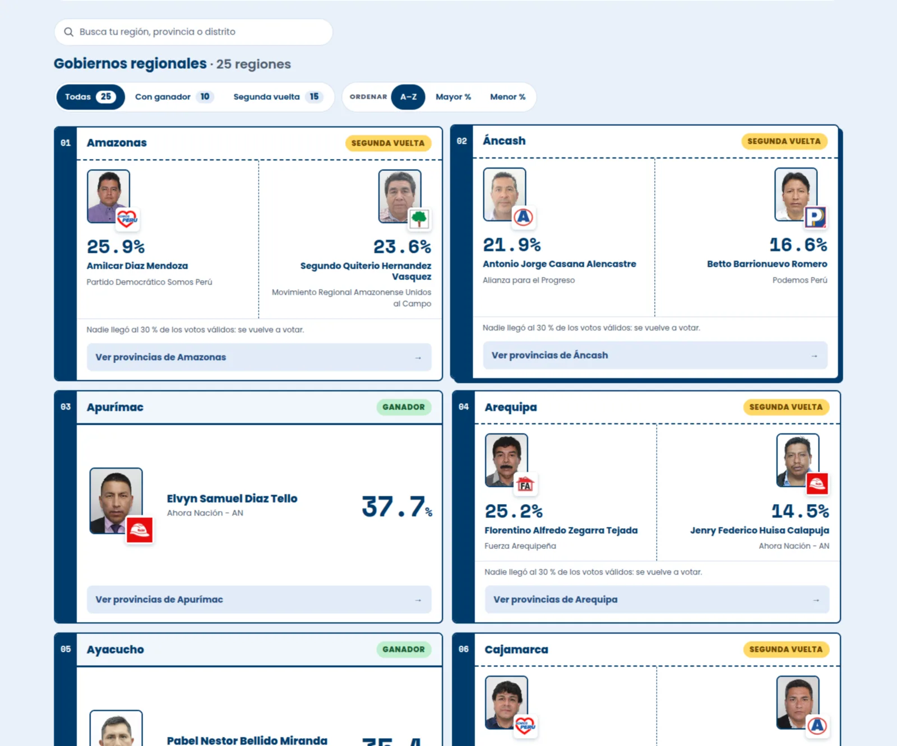

# ¿Quién ganó?

Resultados de las **Elecciones Regionales y Municipales 2026 (ERM 2026)** del Perú, presentados de
forma simple: en cada región, provincia y distrito, quién ganó o quiénes van a segunda vuelta,
con su partido (por logo), su foto y su porcentaje.

**[Ver la página → quiengano.mangosphere.tech](https://quiengano.mangosphere.tech)**

Busca tu región, provincia o distrito y ve de un vistazo quién ganó, qué partidos lideran y
quiénes pasan a segunda vuelta (en gobiernos regionales, si nadie llega al 30 % de los votos válidos).




## Cómo está armado

El proyecto tiene dos partes: un **scraper** que descarga los resultados oficiales y una
**página web** que los muestra.

```
ONPE (resultados, logos) ──┐
                           ├──► scraper/ ──► data/2026-erm/ ──► npm run sincronizar-datos ──► frontend/ ──► página estática
JNE (fotos, motivos)  ─────┘                (local, fuera de git)                             (datos en el repo)
```

| Carpeta       | Qué es                                                                           | Documentación                          |
| ------------- | --------------------------------------------------------------------------------- | --------------------------------------- |
| `scraper/`  | Python 3.13 + uv. Descarga de la ONPE y el JNE y guarda JSON, CSV, logos y fotos. | [scraper/README.md](scraper/README.md)   |
| `frontend/` | Next.js. Genera la página estática a partir de los datos ya convertidos.        | [frontend/README.md](frontend/README.md) |
| `data/`     | Salida del scraper. No se sube a git; se regenera corriendo el scraper.           | —                                      |

## Inicio rápido

Para ver la página (los datos ya están en el repo):

```bash
cd frontend
npm install
npm run dev
```

Para actualizar los datos desde la ONPE y el JNE:

```bash
cd scraper
uv run playwright install chromium
uv run src/main.py
cd ../frontend
npm run sincronizar-datos
```

## Integración y despliegue

Con GitHub Actions (`.github/workflows/`):

| Workflow       | Cuándo                        | Qué hace                                                                                                           |
| -------------- | ------------------------------ | ------------------------------------------------------------------------------------------------------------------- |
| `ci.yml`     | Pull request hacia `develop` | Scraper: Ruff (lint y formato). Frontend: ESLint y `next build` (incluye tipos). Solo corre la parte que cambió. |
| `deploy.yml` | Push a `main` (o a mano)     | Construye el frontend y lo publica en GitHub Pages.                                                                 |

Flujo de ramas: `feat/*` → PR a `develop` → PR a `main` (publica).

Para que el deploy funcione, en *Settings → Pages* del repositorio la fuente debe ser **GitHub Actions**.
Para usar un subdominio, configúralo en esa misma pantalla y crea en tu DNS un registro `CNAME` que
apunte a `<usuario>.github.io`.

## Datos y fuentes

Toda la información viene de **fuentes públicas y oficiales del Estado peruano**:

- **ONPE** — Oficina Nacional de Procesos Electorales
  ([resultadoelectoral.onpe.gob.pe](https://resultadoelectoral.onpe.gob.pe)): resultados, organizaciones
  políticas, logos y ámbitos geográficos.
- **JNE** — Jurado Nacional de Elecciones, plataforma Voto Informado
  ([votoinformado.jne.gob.pe](https://votoinformado.jne.gob.pe)): fotos de los candidatos y estado de
  las candidaturas (renuncias, exclusiones, tachas…).

Este proyecto no crea ni modifica resultados: solo los descarga, los ordena y los presenta.

### Uso de los datos

- Si usas este repositorio como base o extraes información de él, por favor **cítalo** y menciona
  como fuente original a la **ONPE y al JNE**.
- **No es un sitio oficial.** Los datos corresponden a la fecha de descarga indicada en cada archivo
  (`generado_en`). Ante cualquier diferencia, prevalecen los resultados publicados por la ONPE y las
  resoluciones del JNE.
- Los **logos** de las organizaciones políticas y las **fotos** de los candidatos pertenecen a sus
  respectivos titulares. Se muestran solo con fines informativos y no están cubiertos por la licencia
  de este repositorio.

## Autoría

Hecho por Margarita ([mardecode](https://github.com/mardecode)) · Mangosphere.
[LinkedIn](https://www.linkedin.com/in/mardecode/)

## Licencia

El código está bajo licencia [MIT](LICENSE).
